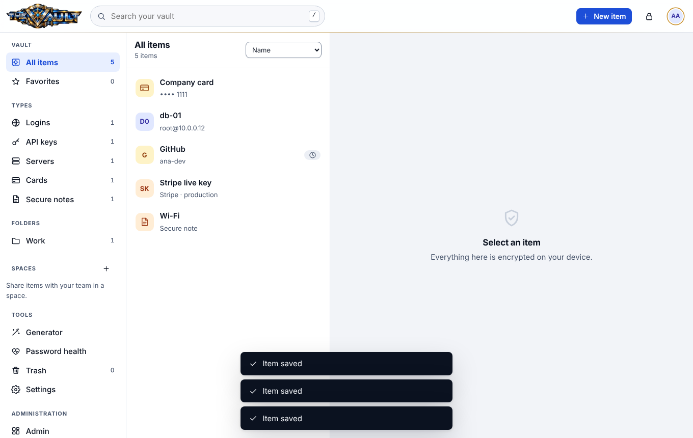
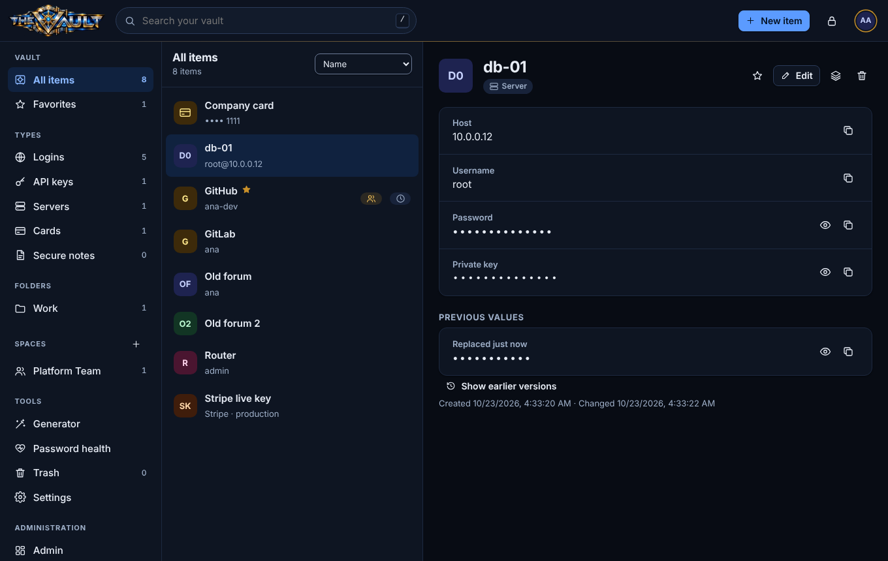

<p align="center"></p>

# TheVault

The company password and secrets manager: logins, API keys, server credentials, cards and notes, with shared team **spaces**, a **Chrome extension** that fills passwords and one-time codes, and a web app to manage it all. Staff sign in with **ClosedDoor** single sign-on; **SkyNet** watches the whole thing and can block attackers.

It is **zero-knowledge**: everything is encrypted in the browser with keys derived from each person's master password. The server stores ciphertext and cannot read your vault, nor can an administrator, a backup, or an attacker who steals the database. See [docs/crypto.md](docs/crypto.md).

| | |
|---|---|
|  |  |

## What you get

* **Vault**: logins (with live TOTP codes), API keys (with expiry), servers (with private keys), cards, secure notes. Folders, tags, favorites, search, trash (30 days), password history and earlier versions.
* **Spaces**: share items with a team. Per-person keys, owner / editor / viewer roles, signed key sharing with fingerprints, and mandatory key rotation when someone is removed.
* **Chrome extension**: fills on your click or `Ctrl+Shift+L`, only on an exact match of the saved website, never into hidden fields or foreign frames, offers to save and update logins, copies codes, locks itself, works offline from an encrypted copy.
* **Generator** (passwords and passphrases), **password health** (weak, reused, old, insecure, expiring), **import** from Chrome, Bitwarden, 1Password and LastPass, **encrypted export**.
* **Protection**: ClosedDoor sign-in, a separate master password, throttled unlocking with lockouts, a recovery key, device list with remote sign-out, per-person activity log, administrator tools that only see metadata, and every security event streamed to SkyNet, which can also tell TheVault to block an address (signed commands, never-block list).

## Run it (Portainer / Docker)

1. **ClosedDoor**: *Admin → Applications → Register* a **confidential** app.
   * Redirect URI `https://<vault-host>/auth/callback`, post-logout URI `https://<vault-host>/login`.
   * Grant access to the people who should use the vault. Give vault administrators the role label `admin`.
2. **SkyNet** (recommended): *Agents → Create enrollment token*, type *PHP / web adapter*. See [docs/skynet.md](docs/skynet.md).
3. Create the data directory and make it writable by the container user: `mkdir -p /srv/thevault/data && chown -R 10002:10002 /srv/thevault/data`.
4. Deploy [`deploy/docker-compose.yml`](deploy/docker-compose.yml) as a Portainer stack with the variables from [`deploy/.env.sample`](deploy/.env.sample).
5. Put a TLS-terminating reverse proxy in front of port 8444. TheVault refuses to run with an `http://` address except on localhost.

Upgrading = pull the new image and redeploy. All state lives in the mounted data directory and migrations run at start-up. **Back up `/data`** (`thevault backup` makes a consistent snapshot): it holds only ciphertext, but the keys under `/data/keys` (the pepper and the cookie key) are needed to use it.

## The extension

Download it from *Settings → Browser extension* in the web app (the server embeds the package), unzip, open `chrome://extensions`, enable *Developer mode*, *Load unpacked*, pick the folder, pin the icon, sign in. The extension has a fixed key, so its id is `gfnpigdeagehjmdcmkijcmgfadlpnlbl`, which is the default of `VAULT_EXTENSION_IDS`. For a fleet, force-install a signed build through Chrome policy; see [docs/extension.md](docs/extension.md).

## Layout

```
server/       Go server: API, storage, SSO, SkyNet, embedded web UI      cd server && go test -race ./...
  internal/web/static/js/core/   the crypto core, shared with the extension (no dependencies, WebCrypto only)
  internal/web/static/js/app/    the web app (no framework, no build step)
extension/    Chrome MV3 extension (copy of core/ is generated: npm run sync)
tests/        node tests for the core, browser tests (web app and extension), colour contrast
deploy/       Dockerfile, Portainer stack, env sample
docs/         architecture, crypto, security, threat model, API, SkyNet, extension, operations
```

## Documentation

| | |
|---|---|
| [architecture](docs/architecture.md) | components, data layout, request flow |
| [crypto](docs/crypto.md) | key hierarchy, formats, what the server can and cannot see |
| [security](docs/security.md) / [threat model](docs/threat-model.md) | controls, audit events, attackers considered, honest limits |
| [api](docs/api.md) | every endpoint |
| [skynet](docs/skynet.md) | events, detection rules, signed block commands |
| [extension](docs/extension.md) | install, autofill rules, permissions, sign-in flow |
| [operations](docs/operations.md) | settings, backup, upgrade, admin tasks, troubleshooting |
| [ui](docs/ui.md), [development](docs/development.md), [testing](docs/testing.md) | for contributors |

## Tests

```bash
cd server && go test -race ./...     # API, sessions, throttling, spaces, extension sign-in, SkyNet (fake SSO, fake SkyNet)
npm install && npm test              # crypto core: RFC vectors, tamper tests, phishing URL cases
node tests/ui/run.mjs                # real server + headless Chromium: every screen, CSP, Trusted Types, axe, screenshots
node tests/ext/run.mjs               # the real extension: sign-in, autofill, phishing cases, save bar, offline
node tests/skynet/run.mjs            # against a real SkyNet checkout: enroll, ingest, a rule fires, signed block_ip is enforced
python3 tests/contrast.py            # WCAG AA for the colour tokens
```
